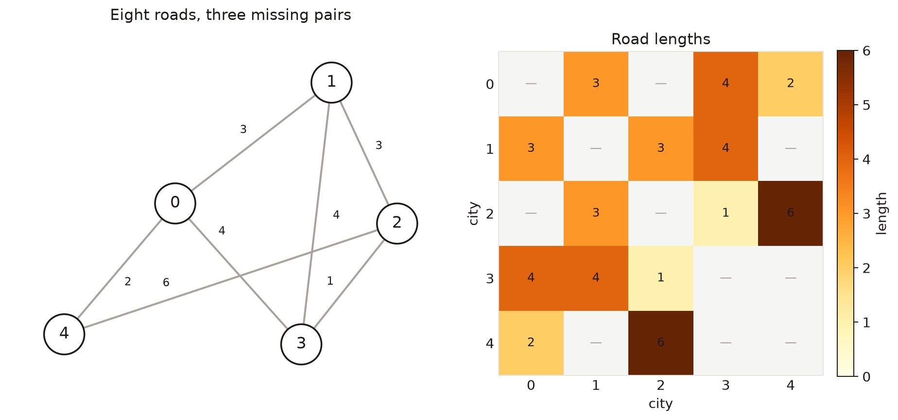
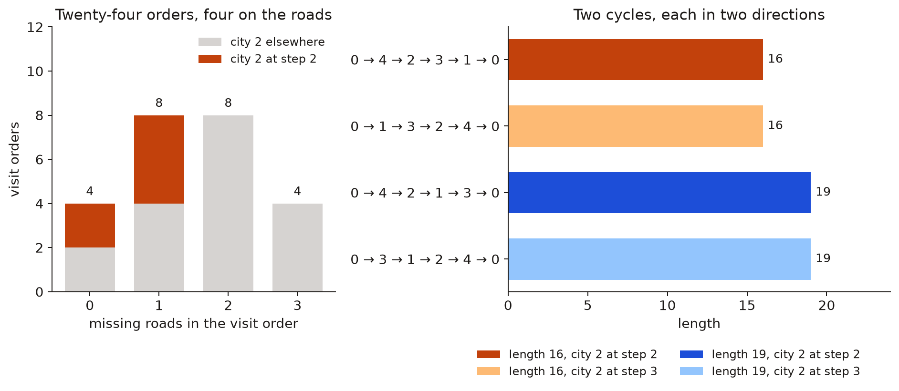
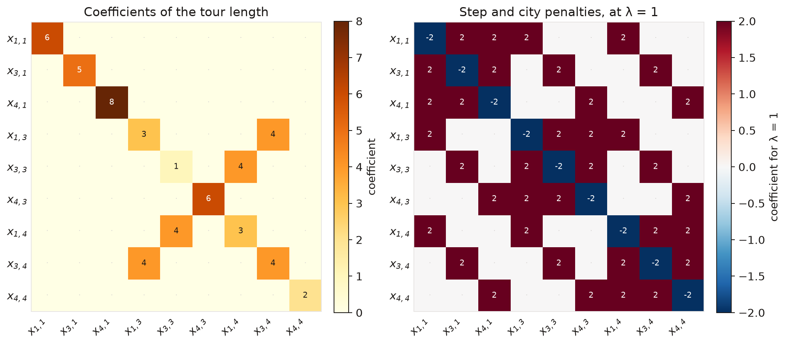
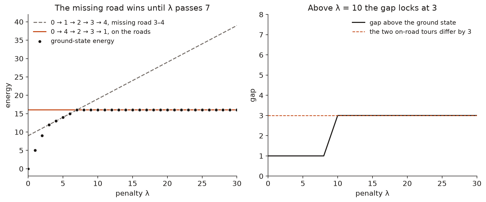
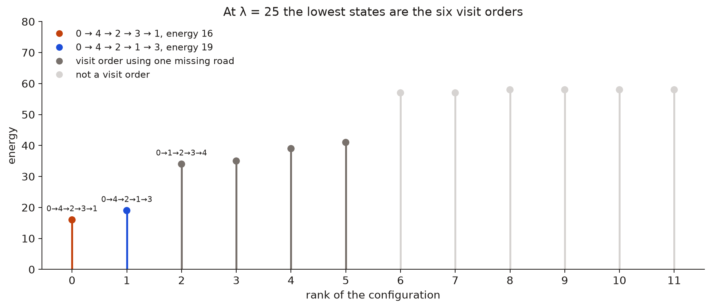
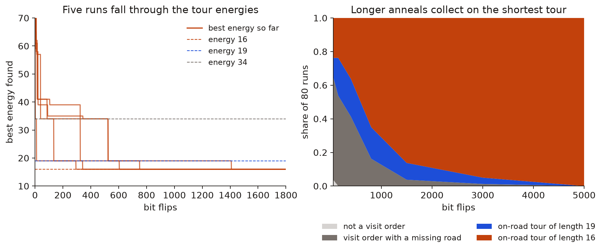
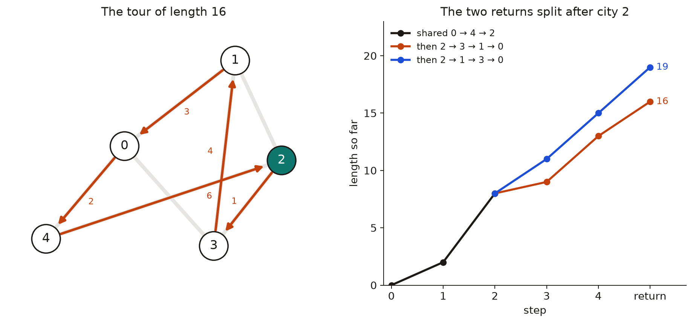

# A quantum QUBO for a constrained TSP

A constrained traveling salesman problem can be written as one quantum QUBO. Route cost, forbidden roads, and the required visit order sit in a single energy, and the optimal tour is the ground state of that energy. The minimum is computed exactly and recovered by simulated annealing.

The case below is a sparse road network. Five cities are joined by eight roads. A tour has to leave city 0, visit every city once, return to city 0, and reach city 2 as the second city after departure. There is no road between 0 and 2. Under that constraint the ground state is $0 \rightarrow 4 \rightarrow 2 \rightarrow 3 \rightarrow 1 \rightarrow 0$, of length 16.

## The roads



The roads and their lengths are $0{-}1$ of length 3, $0{-}3$ of length 4, $0{-}4$ of length 2, $1{-}2$ of length 3, $1{-}3$ of length 4, $2{-}3$ of length 1, and $2{-}4$ of length 6. The matrix is blank on the diagonal and on the three pairs with no road: $0{-}2$, $1{-}4$, and $3{-}4$.

City 4 is the only city of degree 2. Its roads are $0{-}4$ and $4{-}2$. Every closed tour therefore contains the block $0{-}4{-}2$. Starting from city 0, that block can be traversed in two directions. Leaving along $0 \rightarrow 4 \rightarrow 2$ puts city 2 at step 2, which is the required position. Returning along $2 \rightarrow 4 \rightarrow 0$ puts city 2 at step 3.

The pair $0{-}2$ is not a hop of either direction. City 2 is between city 4 and whichever city follows it, never beside the depot. A length assigned to a direct road from 0 to 2 would not enter the feasible tours, and would not move the minimum.

## The tours the roads allow

A visit order is a permutation of $\{1,2,3,4\}$ after the depot. There are $4! = 24$ of them. An order is a tour only when every consecutive pair, including the return to city 0, is one of the eight roads.



Four orders use no missing road, eight miss one, eight miss two, and four miss three. The four that survive are two cycles, each in both directions.

| Direction | Order | Length | Step of city 2 |
| --- | --- | --- | --- |
| Short cycle, outward | $0 \rightarrow 4 \rightarrow 2 \rightarrow 3 \rightarrow 1 \rightarrow 0$ | 16 | 2 |
| Short cycle, return | $0 \rightarrow 1 \rightarrow 3 \rightarrow 2 \rightarrow 4 \rightarrow 0$ | 16 | 3 |
| Long cycle, outward | $0 \rightarrow 4 \rightarrow 2 \rightarrow 1 \rightarrow 3 \rightarrow 0$ | 19 | 2 |
| Long cycle, return | $0 \rightarrow 3 \rightarrow 1 \rightarrow 2 \rightarrow 4 \rightarrow 0$ | 19 | 3 |

Both directions of a cycle have the same length. The visit constraint keeps the outward direction, the one that places city 2 at step 2. It does not lengthen the short cycle. It discards the reverse, which is equally short, and it leaves a choice of return.

After the forced departure $0 \rightarrow 4 \rightarrow 2$, cities 1 and 3 are still unvisited. Two continuations stay on the roads:

$$
0 \rightarrow 4 \rightarrow 2 \rightarrow 3 \rightarrow 1 \rightarrow 0,
\qquad
2 + 6 + 1 + 4 + 3 = 16
$$

$$
0 \rightarrow 4 \rightarrow 2 \rightarrow 1 \rightarrow 3 \rightarrow 0,
\qquad
2 + 6 + 3 + 4 + 4 = 19
$$

The first return uses the road $2{-}3$ of length 1. The second uses $2{-}1$ of length 3 and comes back on $3{-}0$ of length 4 instead of $1{-}0$ of length 3. The difference is 3.

## The same statement as an energy

Let $x_{i,t} \in \{0,1\}$ mean that city $i$ is at step $t$, with steps $t = 0,1,2,3,4$ and the return from step 4 to step 0. The depot and the visit constraint fix two occupations,

$$
x_{0,0} = 1, \qquad x_{2,2} = 1.
$$

Each city is visited once, so city 0 and city 2 occupy no other step, and steps 0 and 2 hold no other city. Those variables are removed rather than penalised. Nine variables remain: cities $\{1,3,4\}$ at steps $\{1,3,4\}$.

The energy is

$$
H = H_{\mathrm{length}} + \lambda\, H_{\mathrm{missing}} + \lambda \left(H_{\mathrm{step}} + H_{\mathrm{city}}\right).
$$

$H_{\mathrm{length}}$ sums $d_{ij}\, x_{i,t} x_{j,t+1}$ over the roads, with $t+1$ read modulo 5. $H_{\mathrm{missing}}$ counts the same products over pairs that are not a road. The step and city terms are squared one-hot defects on the nine variables,

$$
H_{\mathrm{step}} = \sum_{t \in \{1,3,4\}} \left( \sum_{i \in \{1,3,4\}} x_{i,t} - 1 \right)^2,
\qquad
H_{\mathrm{city}} = \sum_{i \in \{1,3,4\}} \left( \sum_{t \in \{1,3,4\}} x_{i,t} - 1 \right)^2.
$$

On a state that is a permutation and uses only roads, every penalty vanishes and $H$ equals the length of the tour. The algebra, including the constant term and the passage to an Ising energy, is in [the formulation note](docs/formulation.md).



The left matrix is the length, written as the coefficient of each monomial $x_a x_b$. A diagonal entry is the length already determined by setting that variable: the hop from the depot into step 1 and on into city 2, the hop out of city 2 into step 3, or the hop from step 4 back to the depot. The only off-diagonal entries are 4. They are the road $1{-}3$, the single road that can join step 3 to step 4, counted once for each direction it can be traversed. Every other pair of those two steps is a missing road. Those entries are blank here; $H_{\mathrm{missing}}$ writes $\lambda$ on them.

The right matrix is $H_{\mathrm{step}} + H_{\mathrm{city}}$ at $\lambda = 1$. Each free variable sits in one step constraint and one city constraint, which is the diagonal $-2$. A pair that shares a step or a city contributes $2$. The working energy uses $\lambda = 25$, so this panel is scaled by 25 and then added to the length. The constant $6\lambda$ that comes with the six squared constraints is not drawn; it cancels when each constraint holds.

## The penalty has to clear a gap of 7

The visit order $0 \rightarrow 1 \rightarrow 2 \rightarrow 3 \rightarrow 4$ is a permutation, and it fails only on the road $3{-}4$. Its real roads sum to 9, so its energy is $9 + \lambda$. The on-road tour has energy 16 at every $\lambda$. The missing road is cheaper until $9 + \lambda$ rises past 16, that is until $\lambda$ passes 7.



Below the dashed line the ground state is not a visit order. That is $\lambda \le 2$. At $\lambda = 3$ such a state ties the missing-road tour, both at energy 12. From $\lambda = 4$ to $\lambda = 6$ the missing-road tour is the unique ground state and the markers sit on $9 + \lambda$. At $\lambda = 7$ that line meets 16, so the missing-road tour and the on-road tour are degenerate. From $\lambda = 8$ the on-road tour is the unique ground state and the markers stay on 16.

The gap above the ground state locks at 3 once $\lambda \ge 10$. By then $9 + \lambda$ has passed 19, and the next state is the other on-road tour, whose length does not depend on $\lambda$. At $\lambda = 10$ the missing-road tour is still degenerate with that second tour, both at 19. From $\lambda = 11$ the first excitation is the second tour alone. Raising $\lambda$ further pushes broken states up and leaves the bottom of the spectrum unchanged. The runs below use $\lambda = 25$.

## What the low states are



At $\lambda = 25$ the 512 configurations open on the two on-road tours, at 16 and at 19. The ground state is unique. Next are the four visit orders that each use one missing road, at 34, 35, 39, and 41. The lowest of them is $0 \rightarrow 1 \rightarrow 2 \rightarrow 3 \rightarrow 4$, whose energy is $9 + 25 = 34$. States that are not a visit order begin at 57. The feasible set is exactly the bottom two levels, and they are separated by the same 3 that separates the two returns.

## Annealing down those levels

Simulated annealing flips one variable at a time and accepts an uphill move of size $\Delta E$ with probability $e^{-\Delta E / T}$. The temperature falls geometrically from 40 to 0.05. The cheapest flip turns off city 4 at step 1. The step is then empty and city 4 is missing, which costs $2\lambda = 50$, while the two roads through city 4, of total length 8, drop out of the length. The net rise is 42, and every other flip costs at least that. The chain can leave a tour only while $T$ is still comparable to that barrier. Once the temperature is low, a run stays in the visit order it has reached.



The five traces enter from energies above the frame, step through the missing-road level near 34 and the second tour at 19, and stop at 16. The last of them arrives just after 1,400 flips. They are records of the best energy seen, so the path is a descending staircase rather than the chain's instantaneous energy.

Across 80 independent runs the same staircase is the distribution. After 50 flips, 19 runs have already seen the tour of length 16, 9 are on the tour of length 19, 49 are on a visit order that uses a missing road, and 3 have not reached a visit order. After 150 flips every run has reached a visit order. After 5,000 flips all 80 runs have found the tour of length 16. Longer schedules do not discover a new state. They spend more time high enough to cross from a missing-road order, and from the tour of length 19, down to the ground state.

## The tour



Both feasible tours share $0 \rightarrow 4 \rightarrow 2$. That prefix costs $2 + 6 = 8$, half of the minimum, and it is spent on the two roads out of city 4. The returns then split.

The shorter return is $2 \rightarrow 3 \rightarrow 1 \rightarrow 0$, costing $1 + 4 + 3 = 8$. The longer is $2 \rightarrow 1 \rightarrow 3 \rightarrow 0$, costing $3 + 4 + 4 = 11$. The totals are 16 and 19.

The state that encodes $0 \rightarrow 4 \rightarrow 2 \rightarrow 3 \rightarrow 1$ is the unique ground state of $H$ at $\lambda = 25$, with energy 16, and it is the state the annealer returns. It is the same tour the degree of city 4 selects, followed by the cheaper of the two ways back.

## Reproducing the figures

The numerical record is `results/summary.json`. Regenerating it rewrites that file and the figures in this note.

```bash
pip install -e .
python -m unittest
python -m road_tour
```
